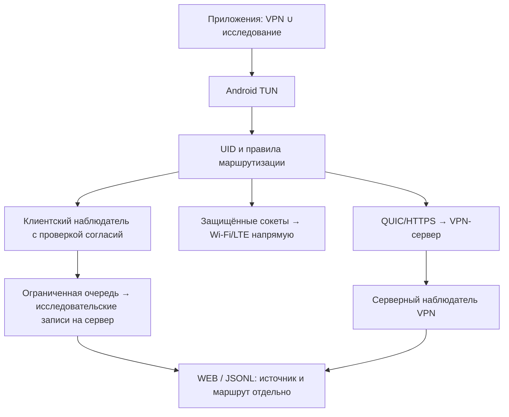

# Охват клиентского исследования: VPN и прямой трафик

Статус: требования согласованы в диалоге; спецификация подготовлена для проверки пользователем. Реализация ещё не начата.

## Цель и границы

Получать в WEB и JSONL сведения «приложение → куда → сколько → когда» также для приложений, не направленных в VPN. Выбор исследуемых приложений не изменяет их маршрут. Первый выпуск поддерживает собственные QUIC/HTTPS; расширение при активном AWG/VLESS — следующий этап. Серверный анализ остаётся только для трафика, реально прошедшего через VPN-сервер.

Анализ работает только во время включённого VPN. Отдельный режим анализа без VPN не создаём. Пользователь может направить в VPN одно приложение без сетевой активности, исследуя остальные через прямой выход. Это не требует наличия полезного трафика в туннеле. Явный Stop завершает весь клиентский сбор; кратковременное восстановление туннеля не считается Stop.

## Режимы

| Режим | Охват |
| --- | --- |
| Только VPN (по умолчанию) | Только потоки, маршрутизируемые в VPN. При выборе всех приложений для VPN — все такие приложения |
| VPN + выбранные приложения | VPN-потоки плюс прямой трафик отдельного сохраняемого списка |
| Все приложения | VPN-потоки и прямой трафик всех доступных для перехвата приложений |

Настройки охвата принадлежат исследованию, а не списку приложений VPN. Дополнительный список сохраняется при переключении режима, остановке и обновлении приложения. Одна и та же запись приложения в обоих списках не создаёт двойного учёта.

«Все приложения» означает доступный текущему Android VPN-интерфейсу трафик. Собственные служебные соединения клиента, другие профили Android и недоступные ОС потоки не выдаются за полностью исследованные. Shared UID отображается как группа возможных приложений, без искусственного распределения байтов.

## Согласия и MDM

Сохраняется основное согласие на исследование. Дополнительно вводится независимое разрешение «Анализ трафика вне VPN», выключенное по умолчанию. Старое согласие не предоставляет новое право. Для прямого сбора нужны оба согласия и действующая политика исследования.

Разрешение доступно локально, при первичной MDM-привязке и при редактировании прав. MDM может задавать охват и дополнительный список только в пределах выданных прав; сервер не может самостоятельно выдавать согласие. WEB показывает желаемый и фактически доступный охват, включая отсутствие разрешения или неподдерживаемый транспорт.

При отзыве дополнительного согласия немедленно прекращается создание новых исследовательских данных прямого трафика, эффективный режим становится «Только VPN». Транспорт и маршрутизация продолжают работу, список сохраняется. Повторная выдача права сама по себе не восстанавливает расширенный сбор: нужен выбор режима локально или новая действующая политика MDM. Основное согласие выключает весь клиентский сбор. История, собранная при действовавшем согласии, сохраняется по обычной политике хранения; её доставка не является новым сбором.

## Архитектура

Используем существующий MultiRouter, FlowOwner и защищённый прямой dialer. Новую параллельную VPN-службу не создаём.

Android получает объединённый охват приложений. Исходные правила VPN остаются авторитетными: дополнительные приложения идут напрямую через protect и подходящую физическую сеть, без зацикливания в TUN. При недоступном VPN его потоки не переводятся автоматически в прямой выход.

Неизвестный UID нельзя интерпретировать как разрешение обхода VPN. При неоднозначной маршрутизации поток не выпускается напрямую; показывается диагностическая причина. Ошибка анализа не останавливает обычную передачу при известном маршруте. Определение владельца и исследовательская запись не должны блокировать UI или ждать сервера.

Переключение режима или дополнительного списка применяется явным действием. Если меняется охват Android TUN, интерфейс предупреждает о возможном кратком переподключении; бесшовность для этой операции не обещаем. Отзыв согласия применяется немедленно в наблюдателе: ради сокращения охвата TUN перезапуск не требуется.

Реализация должна сохранять смысл режимов VPN «все», «выбранные», «кроме выбранных» и маршрутов по подсетям. Подсети не превращаются в полный VPN-маршрут из-за расширенного анализа. Существующие ограничения IPv6 не считаются решёнными этой работой; появившиеся ограничения прямого трафика явно проверяются и показываются, без заявления о полном охвате IPv6.

## DNS, данные и представление

DoH/DoT не расшифровываются. Используем общий ограниченный DNS-декодер для доступного открытого DNS. Системный резолвер и кеш могут не позволять надёжно приписать DNS конкретному приложению: сохраняем неизвестную принадлежность. Прямой DNS не должен незаметно уходить через VPN вследствие нового режима; пути DNS и обычных потоков проверяются отдельно.

К существующим наблюдениям добавляется маршрут vpn/direct/unknown. Он независим от origin и measurement_level. Старые записи без маршрута показываются как неизвестные, если достоверное восстановление невозможно. Клиент не может объявить запись серверной. Прямые клиентские потоки не создают фиктивных серверных потоков.

WEB: маршрут в таблице, фильтре и статистике приложений; источник остаётся отдельным полем. JSONL сохраняет оба признака. Клиентские и серверные байты одного трафика не складываются. Прямой трафик не прибавляется к VPN-трафику в существующих счётчиках; расход доставки диагностики учитывается действующими правилами служебной отправки. Эта функция не меняет согласованные LTE-бюджеты туннелей.

Передаём метаданные потоков и DNS, без полного содержимого пакетов и TLS-секретов. Действуют существующие ограничения очереди, хранения и отправки. Переполнение даёт явный признак пропусков, приоритет — передаче трафика.

## Совместимость

Миграция сохраняет прежний режим «Только VPN», новое право false, дополнительный список пуст. Старый клиент не должен получать политику, которую сервер показывает как успешно применённую: нужна проверка возможностей и явный статус несовместимости.

При активном AWG/VLESS расширенный анализ недоступен: настройки списка сохраняются, UI объясняет ограничение, существующий анализ не расширяется. Для смешанной конфигурации нескольких выходов первый выпуск разрешает расширение только при поддерживаемой конфигурации QUIC/HTTPS; неподдерживаемое сочетание явно отклоняется, без молчаливой смены маршрутов.

## Приёмка

- Три режима, независимость списков, сохранение после перезапуска/обновления, дедупликация приложений.
- На контролируемых TCP/UDP-получателях проверены разные выходные IP: VPN и напрямую; прямой поток отсутствует в серверном наблюдателе VPN.
- Проверены выбранные/исключённые приложения и подсети, неизвестный UID, shared UID, IPv6 и системный DNS; ограничения отражены честно.
- Сопоставлены байты/направления и DNS с контрольными запросами, WEB-фильтры и JSONL; клиент/сервер не удваивают счётчики.
- Отзыв дополнительного и основного согласий в полёте прекращает соответствующий сбор без разрыва VPN; ранее собранная история остаётся доступной.
- MDM без нового права не включает прямой сбор; старый клиент и AWG/VLESS показывают неподдерживаемость.
- Stop прекращает анализ; восстановление процесса не расширяет согласия или охват. Проверены Wi-Fi/LTE, недоступность сервера, переполнение очереди и влияние на задержку/память.
- Go-тесты и сборка выполняются на Linux. Физическая проверка сначала на Note9; вмешательство в личный телефон — в рамках отдельного согласованного теста.

## Следующий шаг

Проверка этой спецификации пользователем, затем отдельный план реализации с последовательностью изменений, миграциями и регрессией. В этой итерации проектирования код и production не меняются.
