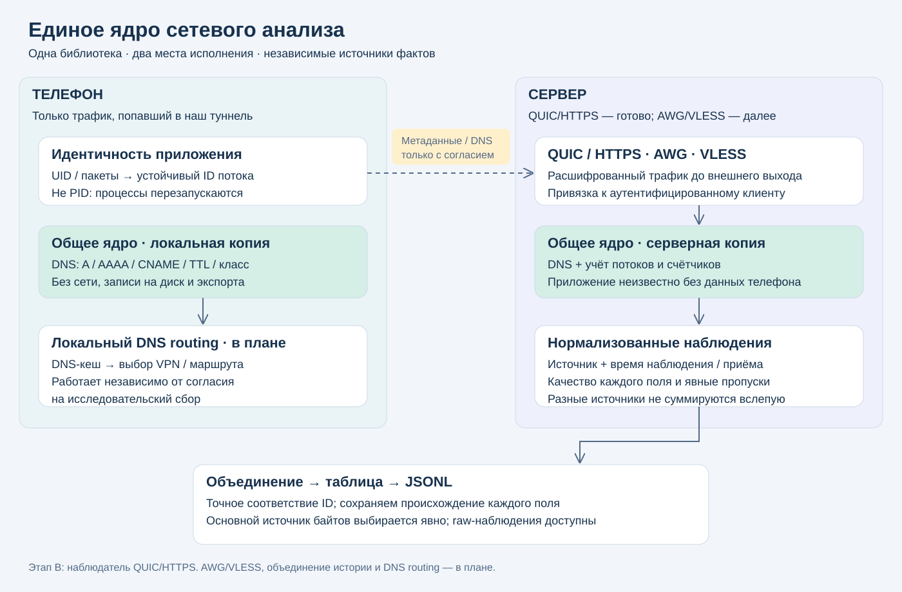

# Единое ядро сетевого анализа

Статус: архитектура согласована в диалоге 11.10.2026; владелец поручил записать план и начать реализацию. Этот документ фиксирует согласованное решение, не включает публикацию на production.

## Назначение
Одна модель наблюдений и JSONL для собственных QUIC/HTTPS и серверных AWG/VLESS. Наш Android-клиент обогащает потоки приложениями; сторонние клиенты остаются видимыми на уровне авторизованного ключа и сетевых соединений. Общий ключ не доказывает идентичность физического телефона.

## Разделение
- `internal/netobserve`: чистые ограниченные декодеры, без сети, диска, Android, политики согласия и экспорта. Одно ядро компилируется в клиент и сервер; это не удалённый сервис.
- Локальный DNS-декодер питает будущий DNS-кеш маршрутизации и, только при согласии, исследовательский экспорт. Отзыв исследования не отключает локальную маршрутизацию.
- Адаптеры получают данные в своих точках наблюдения: Android UID и поток; QUIC/HTTPS логический поток; AWG внутренний пакет после проверки peer и до NAT; VLESS логическое соединение после аутентификации.
- Сервер объединяет явно связанные наблюдения и хранит исходные записи. IP/время/домен сами по себе не являются доказательством принадлежности одному потоку.

## Достоверность и идентичность
Каждая запись имеет origin, время наблюдения at и серверное received_at. Источник назначения сервером авторитетен: клиент не может объявить свою запись серверной. Старые записи без origin остаются legacy_unknown. Приложения, DNS-связь, полнота окна, пропуски и уровень измерения описываются отдельно; единой оценки качества нет.

Ключ связи: авторизованное устройство/ключ + логическая сессия + flow ID, с явным соответствием локального и серверного ID. Дедупликация исходных наблюдений включает источник. Для перехода старые клиентские записи и новые client-записи сохраняют одинаковое пространство дедупликации, без приписывания источника в отображении.

Основной источник байтов выбирается явно. Клиентские и серверные счётчики не суммируются. IP-пакеты AWG и logical_payload прокси не выдаются за одну величину. DNS-ответ — факт; домен последующего IP-соединения может быть только предположением. Противоречия сохраняются.

## Разрешения и ограничения
Наш клиент: отдельное локальное/MDM-согласие, выключено по умолчанию; отзыв не разрывает VPN. AWG/VLESS сторонних клиентов: отдельное серверное разрешение пользователя, выключенное по умолчанию, с явным информированием о включении. Нельзя считать поддержку протокола согласием. Сбор ограничен проходящим через наш сервер трафиком. DoH/DoT не расшифровываются. Произвольное содержимое пакетов и TLS-секреты не сохраняются в режиме потоков.

## Порядок перехода
A — общий DNS-декодер и происхождение наблюдений, без изменения учёта работающего клиента.
B — серверный наблюдатель QUIC/HTTPS, явная привязка application metadata, проверка счётчиков против клиентского источника; только затем сервер становится основным.
C — AWG packet adapter: TCP lifetime/retransmission/fragmentation, UDP timeout, идентичность peer до NAT.
D — VLESS adapter внутри обработчика логических соединений, включая альтернативный клиент.
E — объединённое представление и исходный JSONL, конфликты/пропуски; локальный DNS-кеш с TTL/CNAME/изоляцией выходов и DNS-based routing отдельной задачей.

Первая исполняемая итерация — A. Остальные этапы имеют отдельные приёмочные критерии в плане и не считаются реализованными после выделения библиотеки.
