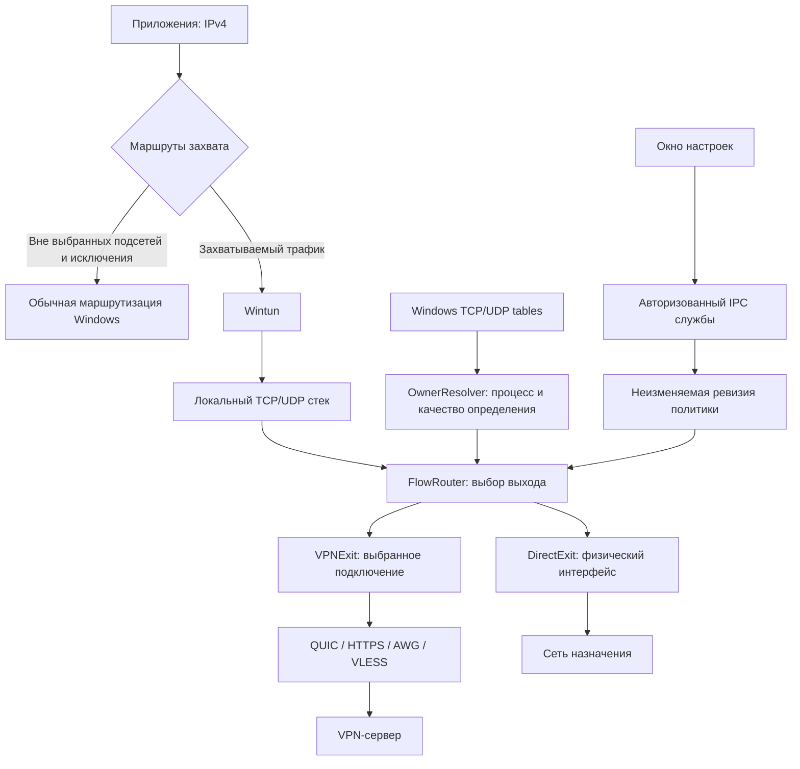

# Windows: маршрутизация приложений через Wintun и локальный direct

Дата: 2026-10-14. Основной архитектурный подход принят владельцем. Документ описывает будущую реализацию, а не уже доступные функции.

Этот документ заменяет прежнее требование обязательного WFP-перехвата в [спецификации Windows](2026-10-03-windows-client-design.md), [оценке механизмов](2026-10-14-windows-interception-assessment.md) и [старом плане](../plans/2026-10-14-windows-app-routing.md). Строгий WFP-вариант остаётся возможным отдельным развитием.

## 1. Решение и границы

Основной вариант: Wintun принимает IPv4-пакеты, локальный движок восстанавливает TCP/UDP-потоки, определяет приложение доступными Windows API и выбирает выход VPN либо `direct`. Собственный WFP callout-драйвер для этого варианта не требуется. Wintun остаётся необходимым драйвером виртуального адаптера.

Поддерживаем две политики с независимыми списками: «только выбранные приложения через VPN» и «все приложения кроме выбранных через VPN». IPv4-подсети остаются отдельным ограничением области захвата. IPv6 не изменяем. Kill switch, MDM, исследовательский сбор и каталог установленных игр не входят в эту доработку.

`direct` — локальный выход в физическую сеть, а не дополнительный сервер. При полном IPv4-захвате через движок проходит также трафик приложений, назначенных в direct. Поэтому это не изоляция выбранных приложений на уровне ядра и не гарантия сохранения связи остальных приложений при аварии движка.

## 2. Схема

Транспортная поддержка зависит от возможностей конкретного выхода. Диаграмма задаёт общий контракт, а не утверждает, что все варианты уже прошли приёмку.

## 3. Компоненты и контракты

| Компонент | Ответственность |
| --- | --- |
| Windows-служба | Wintun, маршруты, DNS, физическая сеть, защищённое хранение и применение настроек |
| OwnerResolver | Исходный сетевой tuple → кандидаты владельцев, экземпляр процесса, путь, качество определения |
| FlowRouter | Политика + атрибуция → выход и объяснение решения до отправки первого полезного трафика |
| ExitRegistry | Идентификаторы выходов; сначала `direct` и текущее VPN-подключение |
| DirectExit | TCP/UDP-сокеты с обходом TUN и привязкой к физической сети |
| VPNExit | Существующие транспортные шлюзы и их возможности |
| UI | Списки приложений, режим, предварительный просмотр изменений, статус и причины решений |

Платформенно независимые сущности: `FlowKey` (протокол, исходный и конечный адреса/порты), `AppIdentity`, `Attribution`, `RouteDecision`, `FlowBinding`. В них нет Windows HANDLE или Android UID как универсальной идентичности приложения.

FlowBinding содержит собственный идентификатор потока, выход, ревизию политики, поколение сети и результат атрибуции. PID не служит идентификатором потока или постоянным ключом правила. Расширение до нескольких VPN-серверов выполняется через ExitID; редактор нескольких серверов не является условием первого этапа.

## 4. Определение приложения

Определение выполняется по исходным адресам и портам до создания исходящего сокета прокси и изменения адресов. Для TCP используем таблицу владельцев соединений и полный tuple. Для UDP таблица содержит локальные адрес/порт и PID владельца bind, но не удалённый endpoint. Учитываем wildcard-bind и неоднозначные совпадения; нельзя выбирать первый попавшийся PID.

После PID получаем путь исполняемого файла и время создания процесса. Кеш процесса привязан к PID и времени создания; повторное использование PID или порта не наследует прежнее решение. Завершившийся процесс, отказ доступа, отсутствие строки и несколько возможных владельцев — явные состояния атрибуции.

Качество: `resolved`, `shared`, `unknown`, `unsupported`. Даже `resolved` означает результат наблюдения через API, а не криптографически доказанную принадлежность пакета. UDP-владелец bind не всегда доказывает отправителя конкретной датаграммы.

Поиск ограничен по времени, памяти и числу параллельных запросов. Первый поток ожидает результат в ограниченной очереди; глобальный цикл приёма пакетов не блокируется. Таймаут и переполнение очереди дают `unknown` с причиной. Численные пределы выбираются по измерениям и фиксируются до live-приёмки. Решение закрепляется за потоком; каждый пакет заново таблицы Windows не опрашивает.

## 5. Политика маршрутизации

| Состояние | Выход |
| --- | --- |
| Выбор приложений выключен | Существующая маршрутизация всего IPv4 или подсетей |
| Только выбранные; приложение в списке | VPN |
| Только выбранные; известное приложение не в списке | direct |
| Все кроме выбранных; приложение в списке исключений | direct |
| Все кроме выбранных; известное приложение не в списке | VPN |
| Все возможные владельцы shared дают одинаковое решение | Этот выход, качество остаётся shared |
| Владелец неизвестен либо кандидаты требуют разных выходов | Явная политика неизвестного владельца |

**Предложенный default для неизвестного владельца — VPN.** Он уменьшает вероятность прямого выхода выбранного приложения, но может отправить в VPN и невыбранное. В настройках предусматриваем явный выбор VPN / direct / блокировать; в интерфейсе показываем активное правило и счётчик таких потоков. Это проектный default, не ранее согласованное требование пользователя. Блокировка отдельных неопределённых потоков не означает наличие системного kill switch.

Правило приложения использует канонический полный путь, не имя файла и не PID. Запущенные процессы и ручной выбор exe — способы заполнения списка. Дочерние процессы не наследуют правило автоматически: Roblox launcher, игра и помощники могут потребовать отдельных записей. Обновление с изменением пути требует обновления правила. Это настройка маршрутизации, не механизм доверия к исполняемому файлу.

Существующие route-exceptions имеют приоритет: исключённая из захвата сеть вообще не попадает в FlowRouter. При режиме подсетей приложение использует VPN только для адресов внутри захвата. Для сценария «Roblox через VPN независимо от адреса» нужен полный IPv4-захват. Изменение области захвата показываем перед применением, не расширяем её молча.

## 6. Direct, DNS и остальные протоколы

Все исходящие сокеты движка, включая direct, транспорт, служебные запросы и DNS, должны использовать существующий механизм обхода TUN. Нельзя полагаться только на маршрут к VPN endpoint: direct-сокеты имеют произвольные назначения. Платформенная привязка к физической сети предотвращает возврат сокета движка в собственный Wintun и повторную атрибуцию службе.

DirectExit возвращает ответы через локальный стек, имеет ограниченные таблицы UDP-сессий и idle timeout. Проверяем TCP, UDP, крупные ответы и очистку сокетов. «Напрямую» означает отсутствие удалённого VPN-выхода; это всё ещё локальное проксирование, а не передача исходного IP-пакета без изменений.

Системный DNS часто принадлежит службе Windows, а не исходному приложению. В первом этапе сохраняем глобальную DNS-политику подключения. Если настроен DNS через VPN, он остаётся через VPN и для приложений с direct-трафиком. DNS внутри приложения, включая DoH, обрабатывается как обычный поток; расшифровка не нужна. Per-app DNS и маршрутизация по доменам — отдельное развитие.

Персональные правила первой реализации относятся к TCP/UDP. ICMP сохраняет существующую общую маршрутную политику и ограничения транспорта, без выдуманной принадлежности процессу. Неподдерживаемые протоколы не объявляем поддержанными только из-за выбора приложения. IPv6 проходит по существующим настройкам Windows, вне этой политики.

## 7. Изменения, сбои и смена сети

Применение создаёт новую неизменяемую ревизию политики. Новые потоки используют её, существующие сохраняют выход до закрытия. Для немедленного переноса активных соединений нужен явно подтверждённый переподъём; нельзя перенести существующую TCP-сессию на другой внешний адрес незаметно для приложения.

Жизненный цикл VPNExit отделяем от DirectExit и общего TUN: переподключение VPN по возможности не уничтожает direct-потоки. Смена физической сети может оборвать оба вида соединений; новый выход выбирается для новых потоков после обнаружения uplink. Поколение сети предотвращает использование устаревших сокетов.

Сбой VPN не переводит тот же активный поток автоматически в direct: поток завершается или ждёт восстановления согласно транспортной политике. После остановки VPN и снятия маршрутов последующие соединения могут идти обычным путём — это согласованный режим без kill switch. Мгновенный fail-open при аварии службы не гарантируется: возможны оставшиеся маршруты и необходимость восстановления. UI не должен обещать, что управление компьютером всегда сохранится благодаря per-app правилам.

## 8. Метаданные и счётчики

Закладываем передачу атрибуции в кастомных QUIC/HTTPS потоках через согласование возможностей сервера. Старый сервер продолжает работать без меток. AWG/VLESS не получают нестандартные расширения. Метка приложения от клиента не является доверенной основой серверной авторизации.

Постоянная идентичность приложения отделена от PID экземпляра. Полный путь, имя пользователя и командную строку не отправляем по умолчанию. Совместимость меток не включает автоматически исследовательский сбор: хранение истории и аналитика требуют отдельной настройки/согласия.

VPN TX/RX не включают direct-трафик. Для диагностики маршрутизации полезны отдельные direct-счётчики и количество unknown/shared решений, без обязательного хранения истории адресов.

## 9. Интеграция и миграция

Переиспользуем Windows SCM/WPF, авторизованный IPC, ревизии настроек, Wintun, физическую привязку сокетов и общий пакетный движок. В `mobile/gateway_tun_link.go` уже есть подключение маршрутизатора; Windows-вход `AttachWindowsLink` пока передаёт nil. `mobile/multiple.go` содержит основу выбора выходов. Новое ядро выделяем в платформенно независимый контракт, Android-адаптер сохраняет текущую семантику UID.

Черновой редактор списков приложений переиспользуем. Старый `internal/approuting` рассчитан на строгую WFP-модель и блокировку; его нельзя просто объявить реализацией этой спецификации. Вводим явно версионированную политику/компиляцию с новой семантикой и тестами. Сохранённый черновик не активируется без применения. Старые профили сохраняют поведение до включения выбора приложений.

Служба повторно проверяет пути, пределы списков, доступность выходов и возможности версии. Несовместимая служба отклоняет новую конфигурацию, а UI не показывает её как применённую. Постоянная настройка и фактическое состояние должны различаться в статусе.

## 10. Этапы и критерии проверки

1. Контракт выходов и direct: реальный TCP/UDP, отсутствие петель, отдельные счётчики и корректное закрытие.
2. Windows OwnerResolver: TCP/UDP, wildcard/shared сокеты, короткие потоки, PID/port reuse, недоступный путь и ограничение нагрузки.
3. Политика и UI: оба режима, независимые списки, неизвестный владелец, предпросмотр захвата, атомарное применение ревизии.
4. Live-приёмка: два приложения к одному адресу через разные выходы, Roblox с UDP и вспомогательными exe; проверка внешнего адреса и реального обмена, а не только состояния UI.
5. Отказы: VPNExit недоступен, direct работает; остановка службы, смена сети, восстановление маршрутов/DNS, неизвестные владельцы, переполнение очереди, сохранение IPv6 без изменений. Каждый заявленный VPN-транспорт проходит собственную матрицу.

Критерий готовности: выходы подтверждены живым трафиком; неизвестная принадлежность отображается честно; прямой трафик не учитывается как VPN; нет рекурсивного захвата; старые настройки не меняют поведение молча. Измеряем задержку первого потока, CPU, память, число сокетов и долю неизвестных владельцев. До этих проверок выбор приложений не объявляется работающим.

## Источники решения

- [Throne: proxy modes](https://throneproj.github.io/guides/proxy_modes/): правила процесса в TUN и прохождение direct-трафика через движок.
- [sing-box v1.12.0: Windows process searcher](https://github.com/SagerNet/sing-box/blob/v1.12.0/common/process/searcher_windows.go): пример поиска PID через Windows socket tables и получения пути. Это конкретная проверенная версия, не утверждение о текущем коде всех клиентов.
- [Microsoft: GetExtendedTcpTable](https://learn.microsoft.com/en-us/windows/win32/api/iphlpapi/nf-iphlpapi-getextendedtcptable).
- [Microsoft: MIB_UDPROW_OWNER_PID](https://learn.microsoft.com/en-us/windows/win32/api/udpmib/ns-udpmib-mib_udprow_owner_pid): локальный endpoint и владелец bind, без удалённого endpoint.
