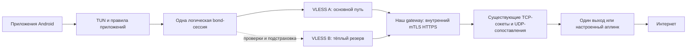

# Общий выход через группу VLESS: основной и тёплый резерв

Дата: 2026-10-17. Статус: спецификация для согласования; реализация ещё не начата.

## Цель и согласованный объём

Android передаёт выбранный VPN-трафик через сторонние VLESS-серверы к одному QUIC Lab gateway. Интернет-соединения открывает gateway через свой действующий выход/аплинк. Смена промежуточного сервера сохраняет внешний IP, логическую сессию и уже открытые конечные TCP-соединения. Пользователь согласовал основной путь и заранее подключённый резерв, с расширяемой архитектурой нескольких путей.

Первая версия: VLESS TCP TLS/REALITY как внешний транспорт, внутренний mTLS HTTPS/WebSocket bond, Android + MDM. По умолчанию одновременно два разных кандидата; один основной, второй тёплый. При единственном доступном кандидате работа продолжается с явным статусом «Без резерва». Остальные члены группы служат кандидатами замены. Постоянное дублирование всего трафика, суммирование скорости, AWG underlay, Windows/Linux UI и автоматическое обновление подписки не входят в эту итерацию.

## Реальная база в репозитории

`internal/bond` уже предоставляет потоковые идентификаторы, ACK, повторную доставку, дедупликацию, ограниченные очереди и выбор предпочтительного пути. `internal/bondhttps/path.go` переносит записи через WebSocket. `internal/gateway/bond.go` объединяет пути по сессионному секрету и сертификату клиента. `mobile/exit_runtime.go` сериализует жизненный цикл кандидатов, бюджеты и поколения физических сетей. Это основа режима; новый независимый протокол восстановления сессий не создаётся.

`mobile/gateway_bond_https.go` пока открывает TCP непосредственно к gateway. Новый адаптер подставляет VLESS Client.DialContext как способ доставки внутреннего HTTPS до того же gateway. Две VLESS-машины имеют независимые движки, сокеты, очереди и отмену; их закрытие не закрывает общую bond-сессию.

## Конфигурация и интерфейс

В профиле VLESS-группы добавляется необязательное поле settings.relay_exit_profile_id: ID существующего профиля нашего QUIC Lab. Отсутствие поля сохраняет текущий standalone-режим с выходным IP стороннего VLESS-сервера. Ссылка должна вести на профиль с HTTPS endpoint, именем сервера и сертификатом клиента; ссылка на себя, цепочка relay-ссылок, отсутствующий профиль и несовместимая идентичность отклоняются до применения.

Группа хранит собственные VLESS-ключи. Сертификат внутреннего канала берётся из выбранного профиля выхода только при построении runtime; не копируется в журналы или обычные MDM-отчёты. Идентичность общей сессии привязана к сертификату нашего сервера, а не к VLESS-кандидату.

Android и MDM: выбор «Выход: напрямую / через профиль QUIC Lab», статус основного и резервного кандидата, готовность резерва, причина последней замены, доступность общего выхода. В первой версии целевой размер пула равен двум; пользовательский выбор произвольного количества откладывается, внутренние структуры не ограничиваются парой полей.

Список приложений, подсети, DNS, лимит LTE и исследовательские согласия сохраняются. Туннельный DNS проходит через общий выход. Включение режима потребует одного переподключения существующего standalone VPN; дальнейшая ротация не пересоздаёт TUN и общую сессию. Никакого скрытого выхода напрямую при недоступности gateway.

Новая capability `vless_relay_v1` обязательна для MDM-применения. Старый клиент не получает новую конфигурацию, включая наследуемые identity. Обычные VLESS-группы и прямые QUIC/HTTPS продолжают работать без изменения семантики.

## Путь, аутентификация и DNS

Для каждого кандидата внешние сокеты VLESS защищены от попадания обратно в TUN, привязаны к выбранной Android Network и учитываются в общем физическом бюджете. Внешнее имя VLESS-сервера разрешается через разрешённую физическую сеть. Внутреннее имя gateway передаётся VLESS как целевой адрес; TLS проверяет реальное имя gateway и mTLS-идентичность. Проверка возможностей gateway тоже должна идти через выбранный VLESS-путь: прямой запрос не является условием запуска в заблокированной сети.

Редиректы внутреннего control/handshake запрещены. Сторонний VLESS не получает секрет присоединения или клиентский приватный ключ в открытом виде. Присоединение к чужой сессии или после отзыва доступа отклоняется сервером независимо от внешнего пути.

## Жизненный цикл и политика

Первый прошедший внутренний handshake путь создаёт сессию. Следующий присоединяется к ней с тем же секретом; не создаёт новую. «Тёплый» означает присоединённый и подтвердивший обмен bond-данными, а не просто доступный TCP-порт. Не более двух присоединённых путей и одной последовательной попытки подключения. Публичные IP кандидатов не обязаны быть различны: разные записи не гарантируют независимые физические маршруты.

Полезные данные идут по предпочтительному здоровому пути. ACK и прогресс полезных данных важнее доступности внешнего порта. Существующий планировщик выполняет ограниченную подстраховку и повторы; серверный планировщик также обслуживает обратное направление. При отказе основного готовый резерв принимает трафик, затем создаётся новый резерв. Нестабильный кандидат уходит в cooldown; автоматический возврат требует периода устойчивой работы существующей pathpolicy, без переключения на каждый более быстрый RTT.

Кандидаты учитывают пару «сервер группы, физическая сеть». Сначала заполняется пул разными серверами на разрешённой предпочтительной сети; смена Wi-Fi/LTE перестраивает внешние пути с сохранением сессии. Ограничения резервных сетей и LTE-бюджет не обходятся ради второго пути. При исчерпании LTE допускается деградация до Wi-Fi без резерва.

Stop закрывает всю сессию намеренно. Поздние события старого поколения не меняют новый запуск. Обновление ключей/состава группы при активной сессии в первой версии явно требует переподключения; бесшовное обновление конфигурации не заявляется.

## Пределы сохранения

Внешний IP остаётся тем же при неизменном выходном маршруте нашего gateway. Перезапуск gateway/аплинка, изменение NAT, отзыв сертификата, гибель клиентского процесса и таймаут самого приложения могут оборвать TCP; сохранение через эти события не обещается.

Существующие значения: DisconnectGrace=120 секунд, таймаут неподтверждённой записи=30 секунд, максимум pending-записей 1024 на сессию и 64 на поток. Первая версия сохраняет эти ограничения и обратное давление. 120 секунд — не обещание 120 секунд сохранности активной передачи. Тест полного отсутствия путей — 10 секунд; тест тёплого переключения — возобновление полезных данных не позднее 3 секунд на управляемом стенде. Это критерий стенда, не SLA мобильной сети. При исчерпании удержания UI явно сообщает о потере сессии; повторный connect не маскируется под бесшовный переход.

UDP сохраняет сопоставление на gateway, но допускает потери и истечение срока доставки; надёжность TCP не переносится на UDP.

## Наблюдаемость

MDM/локальная диагностика: логическая сессия и её поколение, индекс кандидата, физическая сеть, роль, готовность, переключения, восстановленные записи, потери UDP, причины завершения. Без URI, токенов, UUID доступа и сертификатов. Видно отличие «процесс/движок работает» от «общий выход проверен». Физические байты внешних соединений учитываются один раз; внутренние байты отображаются отдельно.

## Приёмка

1. Два управляемых VLESS-прокси к одному тестовому gateway. Один долгоживущий TCP-сокет с последовательными сообщениями и серверным ID принятого соединения; независимая проверка exit IP.
2. Обрыв и blackhole основного пути в обоих направлениях. Неизменны socket/accept ID, логическая сессия и exit IP; данные без пропусков/дубликатов, передача продолжается через резерв.
3. Полный разрыв на 10 секунд с возвратом через другой путь: тот же сокет, контролируемое накопление и обратное давление. Более длительный разрыв проверяет явное завершение, а не скрытый успех.
4. Медленный основной, перестановки, потеря ACK, отказ резерва, недоступные кандидаты, смена сети и исчерпание LTE не создают reconnect-шторм и не превышают лимиты памяти/пула.
5. mTLS, чужой секрет, отзыв, Stop во время dial, старые callbacks, MDM CAS, импорт/экспорт и старый клиент покрыты регрессией.
6. Реальный Android TUN на Note9 с отдельным приложением-генератором: длительная TCP-передача и UDP, принудительный отказ промежуточного пути. После успешного стенда — сборка для Note12. Его действующий VPN не переключается во время разработки.
