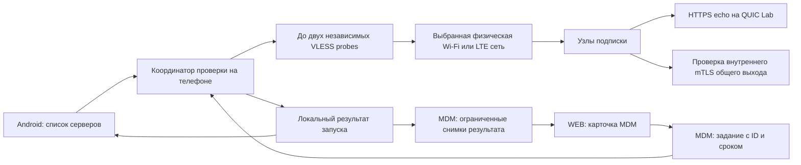

# Проверка серверов VLESS-подписки на Android и через MDM

Дата: 2026-10-17. Статус: схема согласована в разговоре; письменная спецификация подготовлена для проверки. Реализация ещё не начата.

## Цель

На одной странице увидеть, какие узлы импортированной подписки доступны именно из текущей сети телефона. Запуск и остановка доступны на Android и в WEB-карточке MDM. Результаты общие, исполнитель всегда телефон. Рабочий VPN и его TCP-сессии не переключаются ради проверки.

Это отдельная диагностика доступности. Она не меняет порядок ротации, активный профиль, выбранные приложения или настройки общего выхода. Автоматические периодические проверки и тест скорости не входят в первую версию.

## Основание и выбор подхода

В проекте уже есть `mobile.VLESSProbe`, поддерживающий отдельный VLESS-клиент, привязку сокетов к сети и общий TrafficBudget. Его HTTPSStatus возвращает только HTTP-код и общую ошибку: этого недостаточно для таблицы стадий и проверки общего выхода. Android VlessSubscriptionsActivity уже показывает подписки. MDM сейчас поддерживает только команды vpn_start/vpn_stop, а старый клиент отвергает неизвестные команды.

Выбран один координатор проверок на телефоне, отдельные диагностические VLESS-клиенты и доставка заданий/результатов через существующий MDM. Проверять узлы с сервера проще, но это не воспроизводит мобильные блокировки. Проверять последовательным переключением рабочего VPN проще интеграционно, но разрывает пользовательские сессии; такой вариант исключён.

## Состав

Компоненты: Go probe выполняет сетевые стадии; Android coordinator управляет очередью/сетью/отменой; локальное хранилище сохраняет результат без секретов; MDM передаёт задания и результаты; два UI отображают одну модель.

## Область проверки

Проверяются узлы уже импортированной подписки либо MDM-группы VLESS. Запуск не скачивает подписку заново и не импортирует новые узлы. Таблица показывает количество проверяемых узлов и поясняет, что это импортированный набор. Для группы, полученной через MDM без локальной записи URL подписки, экран доступен из профиля группы.

Снимок набора фиксируется в начале запуска: source ID, revision/fingerprint набора, стабильные ID узлов. Изменение профиля/учётных данных во время проверки отменяет оставшиеся задания с причиной configuration_changed. Названия и номера служат отображению; идентичность результата не зависит от порядка строк.

## Сетевые проверки

1. Разрешить внешний адрес узла через выбранную физическую сеть телефона.
2. Поднять отдельный VLESS TCP TLS/REALITY клиент, привязав и защитив его внешние сокеты от попадания обратно в TUN.
3. Выполнить HTTPS echo до нашего сервера с проверкой сертификата и случайным nonce; проверить точное содержимое ограниченного ответа. Redirect не считается успехом. Это доказывает обмен данными через узел, а не только открытие TCP.
4. Для профиля с общим выходом дополнительно проверить внутренний mTLS и полезный обмен через связанный QUIC Lab gateway. Использовать отдельную краткоживущую диагностическую сессию, не присоединять её к рабочему bond и не менять его primary/reserve. После проверки закрыть все ресурсы этой сессии.

Успех HTTPS и готовность общего выхода отображаются раздельно. Доступный HTTPS сам по себе не означает готовность relay. Для обычного профиля вторая стадия — «не применяется».

Echo endpoint отдаёт только небольшой ответ с nonce, имеет ограничения размера/частоты и не принимает URL назначения. MDM не передаёт произвольную цель: цель HTTPS — сервер привязки для управляемого клиента; для локальной подписки без MDM — quic-lab.vpnc.ru. Цель relay определяется уже настроенным профилем общего выхода. URI подписок, UUID, ключи, токены, тела посторонних ответов в результаты не попадают.

## Очередь, сеть и бюджет

Один запуск на устройство; повторная доставка того же request ID возвращает текущий результат без повторного запуска. Новый запуск при занятом координаторе получает busy. «Повторить неудачные» создаёт новый запуск по неуспешным узлам предыдущего снимка; непроверенные и отменённые узлы явно отличаются от сетевых отказов.

Не более двух probe одновременно и не более 256 узлов. На узел до 20 секунд, на весь запуск до 45 минут; пользователь может отменить в любой момент. Тайм-аут включает DNS и все стадии. Отмена закрывает сокеты и движки, а не только скрывает UI. Прогресс обновляется после завершения каждого узла.

Использовать текущую физическую сеть: сеть активного VPN-пути, при отсутствии пути — системную сеть с INTERNET, исключая VPN. Тип сети и локальное время проверки видны в таблице; точные соты, SSID и координаты для этого не нужны. При потере/смене выбранной сети остановить запуск с network_changed: не смешивать измерения разных сетей. Ранее завершённые результаты сохраняются с меткой прежней сети; новый запуск выполняется явно.

LTE использует общий счётчик и действующие ограничения приложения. Внешние байты учитываются один раз, внутренние echo-байты повторно не тарифицируются счётчиком. Общий бюджет должен принадлежать общему владельцу и переживать завершение probe; нельзя создавать независимый нулевой бюджет, если VPN выключен. Исчерпание бюджета — blocked_by_budget, а не «сервер недоступен».

При активном VPN использовать существующую службу без её перезапуска. Локально при выключенном VPN проверка разрешена, пока открыт экран; уход приложения в фон без действующей foreground-службы отменяет её. Удалённый запуск без допустимого фонового исполнителя возвращает needs_foreground, не включает VPN и не запускает скрытую бесконечную службу.

## MDM и разрешения

Новая capability `vless_probe_v1` с обеих сторон. Старому клиенту задания не передаются; старому серверу новый результат не отправляется. Удалённый запуск требует активной привязки, права VPN и telemetry; без telemetry WEB не предлагает запуск, результат которого невозможно получить. Локальный запуск возможен независимо от MDM, результаты остаются на телефоне при отсутствии разрешения передачи.

Команда содержит request ID, binding/epoch, source ID и ожидаемый fingerprint, действие start/retry/cancel и срок принятия 5 минут. Срок принятия не сокращает уже принятый ограниченный запуск. Старые команды после паузы/смены привязки/перезапуска приложения не переисполняются. После гибели процесса незавершённый запуск становится interrupted. Пауза MDM либо отзыв необходимых прав отменяет удалённый запуск; локальный может продолжаться без отправки. Отзыв telemetry немедленно прекращает публикацию новых результатов.

Снимки результата передаются отдельно от часто меняющейся конфигурации, без увеличения её revision. Каждое обновление содержит run ID и монотонный sequence. Сервер игнорирует старые/повторные снимки и проверяет привязку, epoch, объём, ID набора и права. Остановка адресуется конкретному run ID, чтобы запоздалая команда не остановила следующий запуск. Доставка команды не означает завершение проверки; WEB показывает queued/running/finished/interrupted отдельно.

## Модель результата и хранение

Запуск: ID, инициатор local/mdm, source ID/fingerprint, сеть, startedAt/finishedAt, sequence, состояние, число завершённых/всех узлов. Строка: стабильный node ID, название, endpoint без credentials, номер, роль primary/reserve на момент снимка, стадия, outcome, connectMs, echoRttMs, relayOutcome, measuredAt.

ConnectMs — измеренный интервал установления канала до готовности обмена, не «RTT». Echo RTT — медиана трёх коротких запросов после установки защищённого соединения; число успешных запросов также передаётся. Если реализация протокола не даёт отделить стадию, время называется общим временем проверки, а не выдуманным TCP latency. Таймеры длительности монотонные, даты UTC на проводе и локальные в UI.

Ошибки — ограниченные коды: DNS, timeout, transport, target_tls, unexpected_response, relay_auth, budget, network_changed, canceled, configuration_changed, interrupted. Точная причина показывается только если её надёжно выделяет слой протокола; ошибки REALITY не выдаются за доказанную блокировку оператором. Не пересылать raw exception strings.

Хранить последний запуск на каждый source, максимум 32 источника на устройство, максимум 256 строк/запуск и 512 КиБ/снимок. Старые источники вытесняются по времени обновления. Это не долговременная история мониторинга. На сервере ранее принятые данные сохраняются при отзыве telemetry; новые не принимаются. Последний результат локального запуска передаётся только при наличии разрешений, без скрытой отправки накопленной истории.

## UI

На обеих страницах: «Проверить все», «Повторить неудачные», «Остановить», прогресс, сеть и время. Компактные строки: сервер; HTTPS; общий выход; подключение; RTT; последняя проверка. Ошибка раскрывается в строке. Цвет дополняется текстом; роли primary/reserve видны отдельно от результата теста. Фильтры все/работают/ошибки/не проверены, сортировка по исходному порядку или RTT. Незавершённые проверки не окрашиваются как отказ.

На WEB явно указано «Проверяет телефон», показаны время измерения и время получения, отсутствие свежей связи не превращается в неуспех узлов. Android показывает тот же локальный результат независимо от доступности MDM. Перезапуск Activity не запускает новый тест и не теряет состояние.

## Проверка и выпуск

Go: nonce/размер/redirect/TLS, тайм-аут и отмена, ограничение параллелизма, закрытие движков, байты общего LTE-бюджета. Relay: рабочая сессия и destination TCP accept ID не меняются от диагностического запуска; неподходящая внутренняя identity выдаёт отдельный отказ.

Android: запуск/остановка/повтор, смена сети, snapshot конфигурации, process death, права и capability, отсутствие повторного исполнения команды. MDM: авторизация, CSRF, epoch, TTL, seq, лимиты, совместимость старого клиента и очистка секретов. UI: узкий экран и таблица с 32 узлами.

Физическая приёмка на Note9 с контролируемыми исправным/недоступным VLESS-узлами; один длительный TCP-поток рабочего VPN должен сохранить destination accept ID и точный payload во время проверки. Затем публикация APK/сервера и проверка на Note12 после обновления. Пробинг не требует обновлять рабочую конфигурацию Note12 или принудительно разрывать её сессию.

## Границы результата

Успешный пробинг доказывает обмен в момент измерения до конкретной цели. Он не доказывает доступность любых сайтов, UDP, пропускную способность или отсутствие будущих блокировок. Готовность резерва берётся из runtime отдельно; диагностический успех не назначает узел резервным автоматически.
