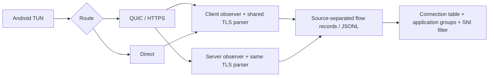

# Research: TLS/TCP SNI and connection view — 2026-10-12

Candidate: Android 0.9.4-pre.4 (60). Initially validated on the old isolated server, ports 18453–18456; deployed to quic-lab.vpnc.ru after user acceptance on 2026-10-13 (Moscow).

## Contract

- Shared bounded `netobserve.TLSProbe` inspects the beginning of the ordered upstream TCP stream. Client observations cover authorized VPN/direct traffic; server observations cover VPN traffic only.
- Metadata: `tls.state`, `server_name`, `ech_offered`, `alpn_offered`, `versions_offered`, in existing flow records and raw JSONL. No schema-breaking required fields.
- `<ECH>` replaces the visible hostname when extension 0xfe0d is offered. Details retain the **outer** name and explicitly say acceptance is unconfirmed and GREASE is possible. This is not evidence of encrypted HTTP headers or a successful ECH handshake.
- SNI identifies a TLS connection, not individual HTTPS requests. No MITM, certificates installed, HTTP/DoH decryption, HTTP/3/QUIC Initial parsing, or application payload capture.
- Missing metadata is explicit: old records, non-TLS, incomplete/missed handshake, malformed prefix, or size limit. A late grant does not reinterpret the middle of an established stream as a ClientHello.
- Prefix budget: 32 KiB, up to 64 TLS records; records can be fragmented across writes and ClientHello across records. Inspection is synchronous bounded CPU work, with no I/O on the forwarding path. Completed classification releases prefix buffers.
- Revocation clears client buffers synchronously and server observers when its control message is admitted; an expired server grant is rejected on payload/periodic flush. Ordinary grant heartbeats remain required.

## UI semantics

Connection identity is origin + device + session + flow ID. Only delta counters within this identity and measurement level are summed. Client and server observations are never added together. Late app identity and TLS evidence enrich a connection before filtering. An open-looking row says “no closing event”, not “currently connected”.

The default history is one row per connection; first eight available events may be expanded, complete raw export remains separate. Processing is capped at 20,000 identities / 32 MiB input and a three-second UI deadline; event detail storage has a four-MiB cap. Partial aggregation is visible. Cursor order is last observed flow event, with a stable identity tie-breaker; live updates can move rows between requests.

Application names are grouped visually, with source/route/exit statistics kept separate. Loss banner reports client diagnostic loss, server observer loss and server store loss separately. Store counters are global storage counters; gaps are scoped to selected identities/time and cannot be assigned precisely to an application. These are lost diagnostic records, not proof of lost application packets.

## Verification

- Parser: fragmented SNI/ECH, non-TLS, late start, oversized/truncated prefix, real Go TLS ClientHello, buffer release. Fuzz run: ~185,000 executions in 21 seconds; no failures.
- Client/server: metadata round-trip, consent gating, revocation without subsequent traffic, regrant in midstream.
- Query/UI: late app metadata, source isolation, ECH filter, pagination, foreign-user isolation, escaped `<ECH>` and GREASE caveat, app-only and repeated-flow aggregation resource bounds.
- Full Linux race suite: `go test -race -gcflags=github.com/xtls/xray-core/proxy/vless/outbound=-d=checkptr=0 -gcflags=github.com/xtls/xray-core/proxy/vless/inbound=-d=checkptr=0 ./cmd/... ./internal/... ./mobile/... -timeout=300s`. Passed; existing Xray checkptr workaround remains necessary.
- Fresh review: fixed idle-server-prefix revocation and app-only aggregation budget bypass. Minor: parser is an observer, not a full RFC-validating TLS stack; some structurally bounded but semantically invalid names/lists may be classified as observed.
- Physical Note9 (Android 11/API 30): final APK passed all 14 probes: QUIC/HTTPS × (SNI fixture, ECH fixture and UDP for VPN/direct, plus real HTTPS through VPN). Preparation and restoration instrumentation tests passed. Original profile restored, VPN and MDM services confirmed running. An earlier successful 14-probe round was followed by one additional closed-pending-flow revocation cleanup and the complete physical round was repeated on the final APK.
- Server JSONL and rendered ECH filter verified against live data: client VPN, client direct, server VPN; no direct observer records on server. Both transport rounds produced expected SNI and ECH evidence. ECH fixtures are synthetic ClientHello bytes carried by TCP echo, not successful encrypted ECH negotiation. Real HTTPS against the owned public site also passed.
- Test harness: running VPN inside Android 11 UiAutomation intermittently failed with `Package android does not belong to 10079`; one run also had UDP echo timeout despite server up/down counters. Final harness prepares a durable restore backup, ends instrumentation, launches the application normally and drives probes externally via ADB. No device-wide hidden API or network restrictions were changed. Normal-launch rounds passed without those failures.
- Physical Note12 (Android 12/API 32), 2026-10-13: installed final 0.9.4-pre.4 (60). Repeat external-harness round passed all 14 probes across QUIC/HTTPS and VPN/direct; preparation/restoration tests passed. Original profile restored; VPN, MDM and telemetry services confirmed running. JSONL and rendered `<ECH>` filter passed (11 controlled connection rows after both runs), including source isolation. First round passed VPN probes and all HTTPS probes, but QUIC direct probes had two TCP timeouts and UDP EPERM; the unchanged repeat passed. Available local diagnostics did not establish the transient cause. This is an unresolved test observation, not a confirmed fixed defect. Private logs: `artifacts/research-live/note12-pre4-sni-final.log` (first round), `note12-pre4-sni-repeat.log`, `note12-pre4-sni-first-results.json`, `note12-pre4-sni-results.json`.
- Candidate SHA256: `97a1021b421c5aa13026be22638fd09b5c710b9b02acba0f27803f20df17c8bf`; 84,619,608 bytes. Test-host checksum and HTTPS download HEAD verified.
- Final extra regression: `TestResearchClosedPendingTLSRevoke` clears parser references for closed flows awaiting app ownership. Focused mobile research race suite passed after this change.

Protocol reference: [RFC 9849, TLS Encrypted Client Hello](https://www.rfc-editor.org/rfc/rfc9849.html), including GREASE ECH and extension 0xfe0d. The visible marker represents an observed extension, not proof of ECH acceptance.

## Production deployment, 2026-10-13

- Built cmd/server on Linux from commit e48a6da with BuildVersion 0.9.4-pre.4; SHA256 `1808a01b7d86f11f4b810ad7f6a9e62d467e5b7a0294a7ed3537f8c4a13ecd13`.
- Replaced the main server and published the exact tested APK. Previous binary and APK retained in root-only `/opt/quic-lab/rollback/sni-pre4-20261013`. No configuration migration.
- Main, VLESS, AWG and transit services active. Public homepage and APK HTTP 200; APK length 84,619,608 bytes and server checksum match. Research endpoint redirects unauthenticated requests to login. No error-priority service journal entries in deployment interval.
- No newly received research records were available during the immediate production check, so fresh production TLS metadata was not verified. End-to-end SNI/ECH and UI verification is from the isolated physical acceptance tests above.

## Consent screen follow-up, 0.9.4-pre.5 (61)

- Refresh the separate direct-traffic consent checkbox on resume from MDM; preserve draft scope and selected apps. Read current rights on click instead of captured activity-creation state. Clearly disable scope editing when MDM controls configuration.
- Note12 regression failed on pre.4 with `expected true but was false`, passed on pre.5. ResearchScopeTest suite returned OK (7 tests; opt-in screenshot test skipped). No device consent or research scope changed by the regression.
- Installed on Note12; VPN, MDM and telemetry foreground services confirmed after normal launch. Published APK SHA256 `9efe84ae93482b2a1ebbb69b2fd2fa68ccc1fdc03c5992ae6fba60fac24bfb21`; remote checksum matched.
